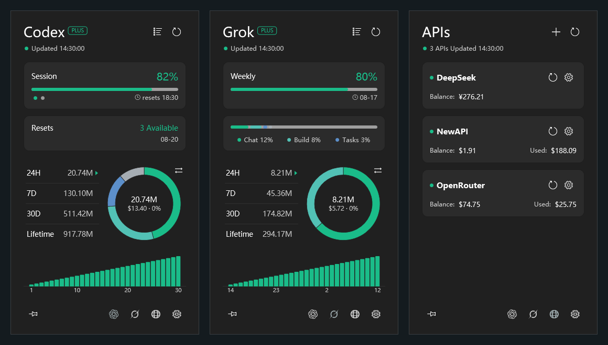

# CodexTray

## 目录

- [概览](#概览)
- [效果展示](#效果展示)
- [功能](#功能)
- [安装](#安装)
- [使用](#使用)
- [Token Cost](#token-cost)
- [Grok 页面](#grok-页面)
- [API 监控](#api-监控)
- [插件支持](#插件支持)
- [数据与隐私](#数据与隐私)
- [常见问题](#常见问题)

## 概览

`CodexTray` 是一个适用于 Windows x64 的托盘应用, 用于查看 Codex 与 Grok 的剩余额度, 重置时间, token 用量与费用, 也支持监控多个 API 账户的余额或费用. Grok 页面显示订阅名称. 点击托盘图标即可查看, 平时无需保持窗口打开.

配合 LiteMonitor 或 TrafficMonitor, 还可以在监控器中显示 Codex Weekly 和 Grok Weekly 的剩余百分比, 以及第一张 DeepSeek 卡片的 CNY 余额.

本文介绍功能, 安装和使用方法. 开发维护说明见 [AGENTS.md](AGENTS.md).

## 效果展示

## 功能

- 查看 Codex 计划状态, Session 与 Weekly 额度, Resets 数量及最近到期时间.
- 在 Grok 页查看订阅类型, Weekly 额度, 各产品使用占比和 Token Cost.
- 按时段查看 token 总量, 费用, 缓存命中率, 模型占比和用量趋势.
- 在 APIs 页添加多个余额或费用监控卡片, 自定义名称, 调整顺序或删除.
- 自动刷新并显示刷新状态, 也可以随时手动刷新. Codex, Grok 和 APIs 完成采集后各自立即更新, Codex 与 Grok 的额度和 Token Cost 也分别更新, 不必等待其他来源.
- 各页面的刷新按钮只刷新当前来源, API 卡片的重试按钮只刷新该卡片. Settings 的 Advanced 一栏提供 `Copy diagnostics`, 一次复制所有来源的应用版本, 各部分最后成功时间和错误分类, 便于排查认证, 网络, 超时, 限流或响应格式问题; 不包含卡片名称, 地址或凭据. 暂时故障会有限重试, 服务要求较长等待时请稍后手动重试.
- 读取失败的数值与插件数据显示 N/A, 不沿用旧值. 费用旁的 `*` 表示部分费用.
- 支持浅色, 深色和跟随系统的主题, 可隐藏不使用的页面, 设置随 Windows 启动.
- 配置读取或备份写入失败时显示错误并保留原文件, 保存操作会暂停. 已成功读取的有效配置仍会继续使用. Settings 的 Advanced 一栏提供 `Restore last good settings`, 可恢复上一份有效配置, 恢复前会另存当前文件. 没有有效备份时, 请修复原配置或目录写入权限后重新启动.
- 托盘悬停显示可见来源的 Codex Weekly, Grok Weekly 和第一张 DeepSeek 卡片余额, 不可用时显示 N/A. 面板左下角的图钉可固定显示, 再点一次恢复失焦收起; Esc 或托盘左键仍可收起, 固定状态只保留到应用退出.
- 自动检测 LiteMonitor 与 TrafficMonitor 目录, 一键安装插件.
- 在 Settings 页检查 GitHub 上的新版本, 确认后完成升级.

## 安装

1. 从 [GitHub Releases](https://github.com/SnowyLake/CodexTray/releases) 下载 `CodexTray-vX.Y.Z-win-x64.zip`.
2. 解压完整目录, 不要只复制 `CodexTray.exe`.
3. 确认系统已安装 [.NET 10 Desktop Runtime](https://dotnet.microsoft.com/download/dotnet/10.0).
4. 运行 `CodexTray.exe`.

发布包中的 `Resources` 保存图标和模型价格, `Plugins` 保存 LiteMonitor 与 TrafficMonitor 插件文件. 缺少这些目录时, 部分界面或插件安装功能将不可用.

## 使用

首次启动时, 应用会保存默认设置并打开主面板. 之后应用常驻 Windows 系统托盘.

使用 Codex 或 Grok 页面前, 请先在本机登录对应的 Codex 或 Grok Build. CodexTray 会使用已有登录信息. 本机已登录 Cursor 时, Grok 的 Token Cost 还会加入 Cursor 云端返回的用量.

- 左键单击托盘图标: 打开或隐藏主面板.
- 右键单击托盘图标: 使用 `Open Panel`, `Refresh Now` 或 `Exit`.
- Codex 页: 查看额度, Resets 和 Token Cost. 点击额度卡片左下角的页点或使用鼠标滚轮切换 Session 与 Weekly. Session 仅在有效时显示. 标题栏刷新按钮左侧可以打开 Session Logs, 再点一次回到额度与 Token Cost.
- Grok 页: 查看订阅类型, Weekly 剩余额度, 重置时间, 各产品使用占比和 Token Cost. 订阅名称来自 Grok Build 设置中的显示名, 旧档会显示成对应的 The X Subscription 名称. Weekly 额度和各产品占比来自额度查询. Session Logs 按钮与 Codex 页相同, 只显示 Grok 自己的记录.
- APIs 页: 添加和查看 OpenAI, DeepSeek, OpenRouter, Vercel AI Gateway 或 NewAPI 监控卡片.
- Settings 页: 调整刷新间隔, 主题, 重置时间格式, 自启动和插件设置. 在 `Visible pages` 中隐藏页面后, 对应的后台采集也会停止. 版本号右侧的 `Check for updates` 会检查 GitHub Release. 发现新版本时, 弹窗询问是否安装.
- About 页: 查看当前版本, 项目主页和许可证信息.

再次运行 `CodexTray.exe` 不会启动第二个实例, 而是通知已有实例打开主面板.

默认每 1 分钟刷新一次, 可在 Settings 中设为 1 到 1440 分钟. 主题支持 `System`, `Light` 和 `Dark`; 应用内悬停提示使用统一的 WPF UI 风格, 随主题切换浅色和深色外观. Windows 11 支持 Mica 背景, Windows 10 使用纯色背景. 主页面按导航顺序左右滑入并淡入, 向右切页从右侧进入, 向左返回从左侧进入, 底部导航保持固定; 仅打开 Session Logs 时从下方滑入并淡入, 返回统计时从上方滑入并淡入; 主页面滑动期间切换记录会立即更新内容, 不叠加上下动画; 托盘显隐不重播页面切换动画; 应用内确认对话框保留淡入效果; 关闭 Windows 客户区动画时, 这些过渡直接显示最终状态. Codex 和 Grok 的图表区域显示时, 圆环各分段同时独立逆时针填充并淡入, 柱形从底部展开; 手动切换图表时段时会播放对应的填充动画, 后台刷新不会重播. 鼠标悬停时当前扇区或柱形轻微放大并同步显示提示, 移到相邻图形时立即切换提示内容, 移开后恢复; 文字和提示保持原尺寸. 刷新和插件检测期间显示进度环, Settings 的自启动, 时间格式与 Mica 使用开关控件.

## Token Cost

Codex 和 Grok 页面都可以按时段查看 token 总量, 费用, 缓存命中率和模型占比, 并切换最近 30 天或当前自然月的趋势图.

- 滚动周期: `24H`, `7D`, `30D`, `Lifetime`. `24H` 表示从当前时刻向前的 24 小时.
- 自然周期: `Today`, `Week`, `Month`, `Year`. `Year` 按本地日历日统计当年 1 月 1 日到今天的用量. 滚动组里的 `Lifetime` 仍是全部历史累计.

悬停 Codex 或 Grok 圆环中的模型可查看 `Speed`, 显示所选时段内有计时记录的平均输出速度. Codex 根据本机会话的单次模型响应窗口估算, 排除输出完成后的工具执行等待, 显示 `~N.N tok/s`; `~` 表示估算值, 且只统计输出较多, 耗时合理的响应. Grok 使用会话中报告的 API 调用耗时计算, 显示 `N.N tok/s`, 只统计有足够输出和耗时的调用, 部分调用未报告耗时时结果可能偏高. 两种口径都包含首 token 等待等开销, 不代表纯生成阶段的速度. 没有可靠计时或费用时, tooltip 不显示 `Speed` 或 `Cost`.

Session Logs 列出本地日志中的每一次用量, 而不是时段合计; Grok 列表不包含 Cursor 云端记录. 每行从左到右是时间, 模型, 速度和费用, 四列宽度固定, 翻页时位置不变, 列间留白均匀. 列表不显示列标题, 费用和速度数值右对齐; 较长的模型名显示省略号. 时间较小, 上面一行是 `YY/MM/DD`, 下面一行是 `HH:MM:SS`. 模型, 费用和速度与模型名一样大. 新的在前, 每页 20 条. 列表滚到底部后可以用滚轮翻页, 底部也可以直接切换上一页和下一页. 费用为 `$0.0000`, 不完整时末尾加 `*`, 没有费用时为 `—`. 速度为整数加 `tok/s`. 没有可靠速度时为 `—`. 采集失败时列表为 `N/A`. 标题栏的列表图标打开后只变成绿色, 再点一次回到用量面板.

两个页面的费用来源不同:

| 页面 | 费用含义 |
| --- | --- |
| Codex | 根据本机会话用量和模型价格估算的 API 等价成本, 不代表订阅实际扣费. DeepSeek 按官方高峰和低谷时段计价. |
| Grok | 本地部分优先使用 Grok Build 会话中记录的费用, 记录缺失或不完整时按模型价格估算. DeepSeek 回算同样区分高峰和低谷. Cursor 云端部分按本地价格表估算 API 等价成本, 并与本地费用相加, 不代表订阅实际扣费. |

没有可用费用记录且价格表未收录的模型, 仍统计 token, 成本按 `$0.00` 计入. 本地记录中的 Codex 自动审查模型 `codex-auto-review` 不计入 token, 费用, 模型占比和 Session Logs; Cursor 云端记录不按模型筛选. Token 数量以 K, M, B 分别表示千, 百万和十亿.

费用不完整时保留已知金额, 并加 `*` 标记; 模型圆环中合并的模型和 `Other` 也会保留该标记. 采集失败时, 趋势图中的已到日期显示 `N/A`.

## Grok 页面

在本机 Grok Build 登录后, 打开 Grok 页面可查看订阅名称, Weekly 剩余额度, 重置时间, 各产品使用占比和 Token Cost. 订阅名称来自 Grok Build 设置中的显示名. `SuperGrok Lite` 显示为 `PLUS`, `SuperGrok` 显示为 `PREMIUM`, `SuperGrok Plus` 显示为 `SUPER`, `SuperGrok Heavy` 显示为 `ULTRA`, `X Premium` 显示为 `PLUS`, `X Premium+` 显示为 `PREMIUM`; 已经是 `Plus`, `Premium`, `Super` 或 `Ultra` 时保持该名称. Weekly 额度和各产品占比来自额度查询.

产品占比默认显示 `Build`, `Bot` 和 `Cursor`. 进度条最多四段, 其余产品合并为 `Others`, 鼠标悬停进度条可查看全部产品占比. 重置时间可以在 Settings 中切换为倒计时或具体时间.

页面下方的 Token Cost 合计本机 Grok Build 会话和统一账本中明确属于 Cursor 的用量. 云端 Grok Bot, Grok Build, Chat 和 Imagine 不纳入. Cursor 内的模型不按名称筛选, 不要求带 `cursor-` 前缀. 时段列表, 趋势图和圆环中心均使用合计值.

Cursor 云端的 Grok 模型统一显示为 `grok-4.x-cursor`, 同版本的 reasoning 和 Fast 变体合并显示, 与本地 Grok 模型分开计算占比. 其他 Cursor 云端模型名末尾保留 `*`. 圆环仍沿用原有规则: 超过四种模型时保留用量最高的前三种, 其余合并为 `Other`. 模型名后的 `*` 表示云端来源, 金额后的 `*` 仍表示费用不完整. Cursor 云端记录不显示在 Session Logs 中, 也不计算 Speed.

Cursor 费用使用本地价格表估算, 其中缓存写入按普通输入价格计算. Cursor Grok 4.5、4.6、4.7 的标准与 Fast 变体分别使用对应价格估算, 圆环按版本合并 token 和各自算出的费用; 无法定价时保留 token 和已知费用小计, 金额后加 `*`. Included 记录在账本中显示的零扣费不作为 Token Cost.

Cursor 未登录, 登录失效或当前用量查询失败时, Token Cost 只显示本地 Grok 用量. CodexTray 不自动续期 Cursor 登录; 需要时打开 Cursor 完成登录, 再刷新面板. 云端只使用新账本, 不拼接旧接口的数据. 历史逐月回溯到首个不可读取的月份为止, 所有周期仅汇总成功读到的记录; `Lifetime` 不保证覆盖账号全部历史. 已读取的用量会缓存到本地, 重启后复用历史, 只刷新本月、上月及尚未读完整的月份. 此前不可读取的更早月份不会在每次重启时反复尝试. 首次没有缓存时仍需下载历史; 若要重新尝试更早历史或核对历史修正, 退出程序后删除 `CodexTray.exe` 同级目录中的 `cursor-usage-cache.json.gz`, 再启动即可.

## API 监控

在 APIs 页点击右上角的添加按钮, 选择 provider 并填写对应信息, 再点击卡片右上角的保存按钮. 卡片设置页中的上下箭头可调整排列顺序, 顺序立即保存. API 监控会按刷新间隔自动更新, 也可以手动刷新. 隐藏 APIs 页后会停止 API 监控采集.

保存只应用于当前卡片. 保存、排序或删除卡片时, 其他卡片尚未保存的字段和新增草稿会保留在编辑状态.

- OpenAI: 填写 Base URL 和组织 Admin key, 默认 Base URL 为 `https://api.openai.com`. 新建卡片默认就是 OpenAI. 卡片显示当前 UTC 自然月已用金额, 标签为 Used. 可以再填写每月起始额度, 单位是 USD, 这是手填数字, 不是 OpenAI 返回的剩余额度. 填写后卡片同时显示 Balance 和 Used, Balance 为起始额度减去当月用量; 用量超过起始额度时 Balance 为负数. 留空则只显示 Used. 普通项目 API key 不能查询.
- DeepSeek: 填写 Base URL 和 API key, 默认 Base URL 为 `https://api.deepseek.com`. 卡片显示 CNY 余额, 第一张 DeepSeek 卡片也会显示在 LiteMonitor 和 TrafficMonitor 中.
- OpenRouter: 填写 Base URL 和 Management Key, 默认 Base URL 为 `https://openrouter.ai`. 卡片显示剩余与已用 credits, 普通 API key 不适用.
- Vercel: 填写 Base URL 和 AI Gateway API key, 默认 Base URL 为 `https://ai-gateway.vercel.sh`. 卡片显示团队剩余 credits 和累计已用量, 普通 Vercel 账号 token 不适用.
- NewAPI: 填写实例 Base URL, access token 和 User ID, 查看剩余与已用额度.

卡片支持自定义显示名称, 调整顺序和删除. Grok 使用独立页面, 不作为 API 监控卡片.

## 插件支持

CodexTray 支持 LiteMonitor 与 TrafficMonitor. 在 Settings 页找到对应监控器, 使用 `Browse` 手动选择目录或 `Auto detect` 自动定位, 然后点击 `Setup` 安装插件. 安装完成后重启对应监控器或重新加载插件.

两个插件都显示 `Codex`, `Grok` 和 `DeepSeek` 三项, 分别对应 Codex Weekly, Grok Weekly 和第一张 DeepSeek 卡片的 CNY 余额. 插件中的 DeepSeek 余额按四舍五入显示为整数, 不带小数. 插件不显示重置时间, Token Cost, Cursor 额度或其他 API provider 的余额. 有多张 DeepSeek 卡片时, 只使用 APIs 页中最靠前的一张.

隐藏 Codex, Grok 或 APIs 后, 对应插件项会显示 `N/A`. 这三项全部关闭后, 应用会停止向插件提供数据.

升级 CodexTray 或修改 HTTP 端口后, 请重新执行 `Setup`, 让插件文件和端口配置同步到监控器.

## 数据与隐私

- Codex 与 Grok 的额度使用本机已有登录信息向各自的官方服务查询. Grok 页的订阅名称来自 Grok Build 设置中的显示名, 读不到时使用本机已有的订阅记录.
- Codex 的 Token Cost 来自本机会话日志. Grok 的 Token Cost 合并本机会话日志与 Cursor 云端用量. Codex 开启「压缩本地聊天记录」后, 较早的会话会保存为 `.jsonl.zst`, 这些压缩日志仍按原来的记录时间计入对应日期. Codex 和 Grok 页面不读取 OpenCode 会话.
- OpenAI, DeepSeek, OpenRouter, Vercel 与 NewAPI 请求直接发送到卡片中配置的 Base URL. API key, Admin key, Management Key, access token 和 User ID 以明文保存在 `CodexTray.exe` 同级目录的 `settings.json` 中.
- API 密钥与 NewAPI User ID 编辑时默认遮挡, 点击输入框右侧的眼睛图标可临时显示和编辑, 再次点击或离开编辑界面后恢复遮挡. 遮挡只保护屏幕显示, 不改变配置文件的明文存储方式.
- Grok 的登录凭据会自动续期并写回本地登录文件, 不会复制到 `settings.json`. Cursor 登录信息只读使用, 加密存储的凭据由当前 Windows 用户解密后用于官方用量查询, 不续期, 不写回, 也不复制到设置文件. Cursor 用量缓存保存在 `CodexTray.exe` 同级目录中的 `cursor-usage-cache.json.gz`, 使用 gzip 无损压缩, 保留时间、模型名和 token 计数的全部明细, 不保存凭据、聊天内容或原始接口响应. 旧版 JSON 缓存会自动迁移, 新文件写入成功后才删除旧文件. 缓存按账号校验, 损坏时自动重新查询; 删除缓存不会影响登录和设置.
- 插件连接仅供本机访问, 默认端口为 `17890`, 不向局域网开放. 登录凭据不会写入日志, 插件配置或插件收到的数据.
- 应用设置保存在 `CodexTray.exe` 同级目录的 `settings.json`.
- 有效配置备份与恢复时保留的原文件也在应用目录中, 凭据同样为明文. 请勿分享 `settings.json`, `settings.last-good.json` 或 `settings.damaged-*.json`.

## 常见问题

### 为什么额度显示 N/A

请确认当前 Windows 用户已登录 Codex, 并且网络可以访问 ChatGPT. 必要时重新登录 Codex, 然后点击 `Refresh Now`.

### 为什么 Token Cost 显示 N/A

请确认已完整解压发布包, 保留 `Resources/model-pricing.json`, 并且本机有对应的 Codex 或 Grok Build 会话记录. Grok 会话需要包含已完成轮次的用量记录.

### 为什么 API 卡片显示 N/A

将鼠标悬停在卡片名称或状态圆点上查看错误信息. OpenAI, DeepSeek, OpenRouter, Vercel 和 NewAPI 需要有效的 Base URL 与凭据. OpenAI 必须使用组织 Admin key, 普通项目 API key 不能查询当月用量. OpenAI 的每月起始额度由用户填写, 用来计算 Balance. NewAPI 还需要 User ID, OpenRouter 必须使用 Management Key, Vercel 必须使用 AI Gateway API key.

### 为什么 Grok 页的订阅名称是 UNKNOWN

请先在 Grok Build 中登录. 订阅名称使用 Grok 设置中的显示名, 读不到时再看本机记录. 仍然没有时显示 `UNKNOWN`. 自动续期失败时, 请运行 `grok login`.

### 为什么 Grok 页面显示 N/A

Weekly 额度和各产品使用占比需要先在 Grok Build 中登录. 自动续期失败时, 请运行 `grok login`.

### 为什么 LiteMonitor 或 TrafficMonitor 没有更新

请确认 CodexTray 正在运行, 且 Settings 中 Codex, Grok 或 APIs 至少有一项开启. 在托盘菜单中点击 `Refresh Now`, 再检查监控器路径并重新执行 `Setup`. 升级后或修改过 HTTP 端口时, 必须重新安装插件. 已安装的旧插件如果仍显示 Cursor, 也需要重新执行 `Setup`.

### 为什么找不到 LiteMonitor 或 TrafficMonitor

自动检测会搜索本机磁盘中的 `LiteMonitor.exe` 或 `TrafficMonitor.exe`. 也可以使用 `Browse` 直接选择包含对应可执行文件的目录.

### 为什么软件内更新失败

软件每次启动及运行中每隔 6 小时自动检查更新, 需要能访问 GitHub. 发现新版本时, 底部 Settings 图标显示消息点, 版本号右侧显示 `New`, 检查按钮切换为安装图标. 点击安装图标并确认后才会下载安装; 自动检查失败时不会弹窗, 已发现的更新提示会保留. 没有更新提示时仍可通过 `Check for updates` 手动检查. 安装目录必须可写, 并且其中已经有完整的发布文件. 从源代码编译运行时, `CodexTray.exe` 旁边会有 `CodexTray.dll`, 这时不能在软件内更新, 请改用发布目录或解压后的安装包. 弹窗中选择 `Install` 后, 程序会退出并替换文件; 更新过程中本地插件接口会短暂中断. 替换失败时会恢复更新前的文件并重新启动.

### 为什么托盘图标没有直接显示在任务栏

Windows 负责管理托盘图标的可见区域. 请在系统托盘展开区或 Windows 的任务栏设置中调整 CodexTray 的显示状态.
