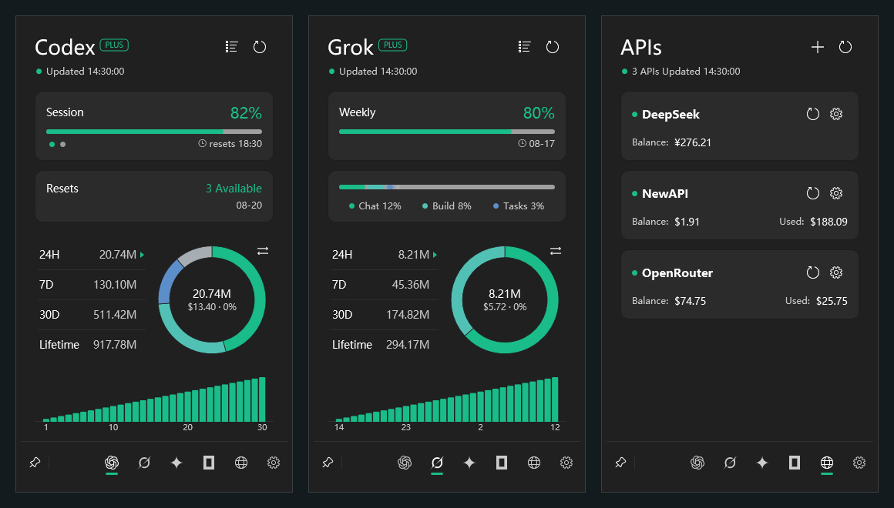

# CodexTray

## 目录

- [概览](#概览)
- [效果展示](#效果展示)
- [核心功能](#核心功能)
- [安装与运行](#安装与运行)
- [快速使用](#快速使用)
- [Token Cost 与费用说明](#token-cost-与费用说明)
- [API 监控](#api-监控)
- [监控器插件](#监控器插件)
- [数据与隐私](#数据与隐私)
- [常见问题](#常见问题)
- [许可证](#许可证)

## 概览

`CodexTray` 是一款面向 Windows x64 的系统托盘应用, 用于在一个轻量面板中查看 Codex, Grok 与 Gemini 的订阅额度, 重置时间, token 用量与估算费用, 同时支持监控多个主流 API 账户的余额或费用.

配合 LiteMonitor 或 TrafficMonitor 插件, 还可以将 Codex Weekly, Grok Weekly 与第一张 DeepSeek 卡片的 CNY 余额直接展示在系统监控栏中.

本文面向最终用户, 介绍安装, 配置与日常使用. 开发与维护规范见 [AGENTS.md](AGENTS.md).

## 效果展示

## 核心功能

- **多平台订阅额度**: 在独立页面查看 Codex (Session / Weekly / Resets), Grok (Weekly 与产品使用占比) 及 Gemini (Gemini 5 小时/周/Argon 高级模型周额度, 以及 Claude & GPT 5 小时/周额度) 的剩余百分比, 订阅档位与重置时间.
- **Token Cost 与趋势分析**: 按滚动周期与自然周期统计 token 总量, 估算费用, 缓存命中率, 模型占比, 30 天或自然月趋势图, 并支持查看本地 Session Logs 明细与平均输出速度.
- **多厂商 API 余额监控**: 在 APIs 页自由添加, 命名, 排序或删除 OpenAI, DeepSeek, OpenRouter, Vercel AI Gateway 与 NewAPI 监控卡片.
- **独立刷新与故障隔离**: 各来源以及各页面的额度与 Token Cost 独立采集并立即更新, 互不阻塞. 失败项显示 `N/A`, 不沿用过期旧值.
- **监控器插件集成**: 自动检测 LiteMonitor 与 TrafficMonitor 目录, 一键部署或同步插件配置.
- **托盘常驻与个性化**: 支持浅色/深色/跟随系统主题, Windows 11 Mica 背景, 开机自启, 隐藏不使用的页面, 面板图钉固定与应用内自动检查更新.

## 安装与运行

1. 前往 [GitHub Releases](https://github.com/SnowyLake/CodexTray/releases) 下载 `CodexTray-vX.Y.Z-win-x64.zip`.
2. 完整解压到普通可写目录, 不要只复制 `CodexTray.exe`. 发布包中的 `Resources` (图标与模型价格表) 和 `Plugins` (监控器插件) 必须保持同目录完整.
3. 确认系统已安装 [.NET 10 Desktop Runtime](https://dotnet.microsoft.com/download/dotnet/10.0).
4. 运行 `CodexTray.exe`.

首次启动会生成默认配置并打开主面板, 之后常驻系统托盘. 重复运行 `CodexTray.exe` 不会启动多实例, 而是直接唤出已有主面板.

## 快速使用

### 托盘与面板操作

- **左键单击托盘图标**: 显示或隐藏主面板.
- **右键单击托盘图标**: 打开菜单, 提供 `Open Panel`, `Refresh Now` 与 `Exit`.
- **悬停托盘图标**: 查看当前可见来源的 Codex Weekly, Grok Weekly 与第一张 DeepSeek 卡片余额.
- **固定与收起**: 点击面板左下角图钉可固定显示 (保持至退出); 再次点击恢复失焦自动收起. 按 `Esc` 或左键托盘图标随时收起面板.

### 页面说明

使用 Codex, Grok 或 Gemini 页面前, 请先在本机登录对应客户端, CodexTray 会自动复用已有登录信息:

- **Codex**: 需本机已登录 Codex. 展示计划档位, Session / Weekly 额度与 Resets 信息. 额度卡片可通过左下角页点或鼠标滚轮翻页 (Session 仅在有效时显示). 标题栏刷新按钮左侧可切换至 Session Logs.
- **Grok**: 需本机已登录 Grok Build. 展示订阅名称 (旧档名统一对应为 The X Subscription 名称), Weekly 剩余额度, 重置时间与各产品使用占比 (悬停进度条可查看全部产品). 下方 Token Cost 同时汇总本机 Grok Build 与本机已登录的 Cursor 账本中的 Cursor / Grok API 用量; Session Logs 仅列出本机 Grok 记录.
- **Gemini**: 需本机已登录 Antigravity CLI (`agy`), Antigravity ACP (如 T3 Code), Antigravity IDE 或 Gemini CLI. 上方大卡片切换 Gemini `Session` (5 小时), `Weekly` 与 `Argon Weekly` (仅服务端返回时显示); 下方小卡片切换 `Claude & GPT Session` 与 `Claude & GPT Weekly`. Token Cost 与 Session Logs 汇总本机 Antigravity (含 T3 Code) 与 Gemini CLI 记录. 当本机 token 临近过期时会自动静默续期; 若续期失效, 状态栏会提示打开对应客户端重新登录.
- **APIs**: 管理自定义 API 余额/费用监控卡片.
- **Settings**: 配置刷新间隔 (1 到 1440 分钟, 默认 1 分钟), 主题, 重置时间格式 (倒计时或具体时间), 开机自启, 可见页面 (`Visible pages`), 插件路径与更新检查. 隐藏某个页面后, 对应后台采集也会停止. `Advanced` 区域提供 `Copy diagnostics` (复制脱敏排查摘要) 与 `Restore last good settings` (恢复上一份有效配置).
- **About**: 查看应用版本, 项目主页与许可证信息.

各页面标题栏的刷新按钮仅刷新当前来源, API 卡片的重试按钮仅刷新单张卡片. 应用启动时及运行中每 6 小时自动检查 GitHub 新版本, 发现更新时在 Settings 导航图标显示提示点, 需手动点击确认后才会下载安装.

## Token Cost 与费用说明

Codex, Grok 与 Gemini 页面均提供按时段汇总的 token 用量, 估算费用, 缓存命中率, 模型占比圆环与趋势图 (支持最近 30 天与当前自然月切换):

- **滚动周期**: `24H` (过去 24 小时), `7D`, `30D`, `Lifetime` (全部历史).
- **自然周期**: `Today`, `Week` (本地周一起), `Month` (本地当月 1 日起), `Year` (本地当年 1 月 1 日起).
- **输出速度 (`Speed`)**: 悬停模型占比圆环或查看 Session Logs 时显示. Grok 基于会话记录的 API 耗时计算 (`N.N tok/s`); Codex 与 Gemini 基于本机响应步骤时间差估算 (`~N.N tok/s`), 仅统计达到输出与耗时门槛的有效样本.
- **部分费用标记 (`*`)**: 当某时段内存在无法估价的模型或字段时, 已知金额后附带 `*` 提示; 模型圆环中云端来源模型名后的 `*` 表示云端记录.

各页面的统计来源与费用口径如下:

| 页面 | 数据来源 | 费用口径 |
| --- | --- | --- |
| Codex | 本机 Codex 会话日志 (含压缩后的 `.jsonl.zst`) | 按本地 `Resources/model-pricing.json` 估算 API 等价成本, 不代表订阅实付 |
| Grok | 本机 Grok Build 会话 + 本机已登录 Cursor 账本中的 Cursor / Grok API 用量 | 本机记录优先使用会话自报费用, 缺失或不完整时按本地价格表回算; 云端部分按本地价格表估算并相加 |
| Gemini | 本机 Antigravity (含 T3 Code) 与 Gemini CLI 会话日志 | 按本地 `Resources/model-pricing.json` 估算 API 等价成本, 不代表订阅实付 |

本地价格表采用官方标准原价估算, 不包含限时促销, 长上下文阶梯加价, 缓存存储或独立工具费用, 历史用量会按当前价格表重算, 不可用于核对历史账单.

## API 监控

在 APIs 页点击右上角添加按钮, 选择服务商并填写配置后保存. 在卡片设置页可通过上下箭头调整顺序 (顺序立即生效). 编辑, 保存或删除单张卡片时, 其他卡片未保存的草稿不会丢失.

远程 Base URL 必须使用 `https://`; 本机代理允许使用 `http://` (仅限 `localhost` 或回环地址). 更换服务商或修改目标地址的协议, 主机或端口时, 已填密钥与 User ID 会自动清空以防误发.

| 服务商 | 默认 Base URL | 所需凭据 | 展示指标 |
| --- | --- | --- | --- |
| OpenAI | `https://api.openai.com` | 组织 Admin key (普通项目 key 不可用) | 当前 UTC 自然月 `Used`; 可选手动填写每月起始额度 (USD), 填写后同时显示 `Balance` (超出时为负) |
| DeepSeek | `https://api.deepseek.com` | API key | 账户 CNY 余额 (第一张 DeepSeek 卡片同步供插件显示) |
| OpenRouter | `https://openrouter.ai` | Management Key (普通 API key 不适用) | 剩余与已用 credits |
| Vercel | `https://ai-gateway.vercel.sh` | AI Gateway API key (普通账号 token 不适用) | 团队剩余 credits 与累计已用量 |
| NewAPI | 用户实例地址 | Access token + User ID | 剩余与已用额度 |

## 监控器插件

CodexTray 支持 **LiteMonitor** 与 **TrafficMonitor**:

1. 在 Settings 页对应监控器一栏点击 `Auto detect` 自动定位, 或点击 `Browse` 选择包含监控器主程序的目录.
2. 点击 `Setup` 部署插件与端口配置.
3. 重启对应监控器或重新加载插件.

插件固定展示三项数据: `Codex` (Codex Weekly), `Grok` (Grok Weekly) 与 `DeepSeek` (第一张 DeepSeek 卡片的四舍五入整元 CNY 余额). 隐藏对应页面后该项显示 `N/A`; 三项全部关闭时停止本地插件服务.

升级 CodexTray 或修改 HTTP 端口后, 请再次点击 `Setup` 同步插件文件与端口配置.

## 数据与隐私

- **复用已有登录**: Codex, Grok 与 Gemini 直接使用本机已有客户端登录查询各自官方接口; Cursor 登录以只读方式读取, 不自动续期或回写.
- **本地配置文件**: 应用设置保存在 `CodexTray.exe` 同级目录的 `settings.json`, 上一份有效备份保存在 `settings.last-good.json`. API 密钥与 NewAPI User ID 以明文保存 (编辑时的眼睛图标仅用于屏幕遮挡, 非加密存储), 请勿分享设置或备份文件.
- **本地缓存**: Cursor 与 Grok API 云端历史用量缓存在同级目录的 `cursor-usage-cache.json.gz`, 不包含凭据或聊天内容. 删除该文件不会影响登录与设置, 下次启动会重新拉取历史.
- **仅限本机访问**: 插件 HTTP 服务仅监听 `127.0.0.1` (默认端口 `17890`), 不对局域网开放, 且仅输出插件所需的精简显示值.
- **脱敏诊断**: `Copy diagnostics` 仅输出应用版本, 固定来源名称, 最后成功时间与错误分类, 不包含 URL, 账号, 卡片名称或任何凭据.

## 常见问题

### 为什么额度或订阅显示 `N/A` 或 `UNKNOWN`?

请确认当前 Windows 用户已登录对应客户端 (Codex / Grok Build / Antigravity 或 Gemini CLI), 且网络可正常访问官方服务. 如自动续期失败, 请在对应客户端重新登录 (如运行 `grok login`), 再点击 `Refresh Now`.

### 为什么 Token Cost 显示 `N/A`?

请确认已完整解压发布包 (保留 `Resources/model-pricing.json`), 且本机存在对应客户端的会话日志.

### 为什么 API 卡片报错或显示 `N/A`?

将鼠标悬停在卡片名称或状态圆点上查看错误原因, 也可在 Settings -> Advanced 点击 `Copy diagnostics` 获取排查分类. 请重点核对是否使用了正确类型的密钥 (例如 OpenAI 需组织 Admin key, OpenRouter 需 Management Key, Vercel 需 AI Gateway API key).

### 为什么 LiteMonitor / TrafficMonitor 没有数据或未更新?

请确认 CodexTray 正在运行且 Codex, Grok 或 APIs 至少开启一项. 升级应用或修改 HTTP 端口后, 须在 Settings 页重新执行 `Setup`. 若 TrafficMonitor 提示缺少 DLL, 请确认发布包中的 `Plugins/TrafficMonitor/CodexTray.dll` 完整存在.

### 为什么应用内更新失败?

请确认能正常访问 GitHub, 且安装目录普通可写 (不支持符号链接/目录联接目录). 若是从源码自行编译运行 (同目录存在 `CodexTray.dll`), 应用内更新会自动禁用, 请改用正式发布包目录运行.

### 为什么系统托盘看不到图标?

Windows 默认可能将新应用收纳进任务栏右侧折叠区, 请在系统托盘展开区或 Windows 任务栏设置中将 CodexTray 设为始终显示.

## 许可证

本项目基于 [MIT License](LICENSE) 开源.
